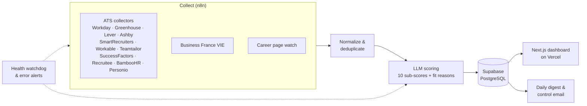

# Job Radar

An automated sourcing system that finds, filters and ranks job offers every day, so that hours of manual searching become a ten-minute review of a ranked shortlist.

I built it for my own search (VIE, internships and junior roles). It started on n8n Cloud and has been running daily ever since. In September 2026, I moved the project to GitHub with a dashboard, tests, CI and automated backups.

> The source code is private. This page describes what the system does and how it is built.

<!-- Add 2–3 screenshots of the dashboard here: overview, opportunity detail with sub-scores, map -->

## Results

- **15 job sources** and **220+ target companies** scanned daily
- **7,000+ offers** reduced by AI scoring to a ranked shortlist
- **99%+ reliability** over **800+ automated runs**

## How it works

1. **Collect.** One n8n workflow per applicant tracking system (Workday, Greenhouse, Lever, Ashby and others) pulls open roles from each target company, plus the official VIE board and a watcher for career pages without an ATS.
2. **Normalize.** Offers are cleaned, canonicalized and deduplicated across sources.
3. **Score.** An LLM (OpenAI API) rates each offer against a configurable target profile on ten dimensions: function, experience, seniority, geography, sector, language, degree, timing, company and opportunity type. It also explains the fit and flags weaknesses (degree or language requirements).
4. **Review.** A password-protected dashboard shows the top matches, opportunity details, companies, a map and the health of every source. From there I can rescore, rerun the radar and mark offers as applied.

## Reliability and safety by design

- **Nothing is ever deleted.** Expired offers are deactivated with a date, and offers marked as applied are never removed.
- **Daily control email** listing every offer set aside in the last 24 hours, with alerts if the AI filter rejects an unusual share of a batch or if average scores drop sharply.
- **Health watchdog and global error alerts** on every workflow.
- **Nightly backups:** database dump and export of every n8n workflow, through GitHub Actions.
- **Secured dashboard:** signed, expiring session tokens; brute-force protection; server-only database keys.
- **Tested:** unit and component tests (Vitest), end-to-end tests against a fake backend (Playwright), and CI running format, lint, type checks, tests and build on every push.

## Stack

n8n · Supabase (PostgreSQL) · OpenAI API · Next.js · TypeScript · Vercel · GitHub Actions · Vitest · Playwright

## How I built it

I designed the product, the data model, the scoring logic and the safeguards, and I operate it every day. The code was written with Claude Code as an AI pair programmer.
